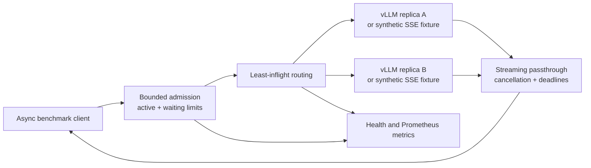

# LLM Serving Lab

A small serving control plane for streaming chat models: bounded admission, least-inflight replica routing, disconnect cleanup, and a client benchmark that measures useful responses under latency SLOs.

The workload uses synthetic shopping histories and product catalogs. The default backend is an explicitly synthetic SSE fixture, so the project runs on a Mac or ordinary CPU machine. It does **not** run an LLM, perform tokenization, or measure GPU/model throughput in that mode. A separate, version-pinned NVIDIA/vLLM recipe is included but has not been GPU-tested.

## What is implemented

- `POST /v1/chat/completions` forwards the OpenAI chat **streaming subset** (`stream=true`) to one of several vLLM-compatible replicas. Other request fields pass through; validation/model support remain the backend's responsibility.
- Least-inflight selection reserves the replica before opening its connection. Round-robin tie breaking avoids a preference for the first idle replica.
- An active-request limit and bounded waiting queue reject overload with HTTP 429 and `Retry-After`. Queue, upstream idle, and total request deadlines have distinct meanings; the total deadline includes admission wait.
- Upstream errors before streaming become HTTP 502/504. Errors after headers become an explicit SSE error event. There are **no retries**, including before the first content, so a partial generation is never silently duplicated.
- Client disconnects close the upstream response and release the replica/admission reservation under cancellation shielding.
- `/healthz` is process liveness; `/readyz` actively probes each upstream `/health` and is ready if any replica responds successfully. Failures temporarily exclude a replica; expiry permits another attempt.
- `/metrics` exposes Prometheus text counters, active/queued gauges, per-replica counts, and duration sum/count. Backend IDs are numeric; metrics do not contain prompts or endpoint credentials.



## Run locally without a GPU

Python 3.11 or later:

```bash
python3 -m venv .venv
source .venv/bin/activate
python -m pip install -e '.[dev]'
python -m pytest -q
python scripts/run_local.py --requests 64 --output results/my-mock-run
```

The last command starts **three actual loopback HTTP servers**, sweeps client concurrency 1/4/8/32, saves every request's timings, and shuts all servers down. It allocates free ports, so it can run alongside other local services. The mock deliberately sends an empty role chunk before content to exercise correct TTFT measurement.

To keep the services running, use three terminals after activating the environment:

```bash
serving-mock --port 8001 --name mock-a --prefill-ms 25 --chunk-ms 5
serving-mock --port 8002 --name mock-b --prefill-ms 25 --chunk-ms 5
serving-gateway --backend http://127.0.0.1:8001 --backend http://127.0.0.1:8002
```

Then, from another terminal:

```bash
serving-prompts --count 64 --seed 42 --output data/prompts.jsonl
serving-bench --dataset data/prompts.jsonl --requests 64 --concurrency 8 \
  --ttft-slo 0.1 --e2e-slo 0.2 --label synthetic-mock-no-model-no-gpu \
  --output results/manual-mock.json
curl http://127.0.0.1:8000/readyz
curl http://127.0.0.1:8000/metrics
```

All application bindings default to `127.0.0.1`. The gateway is a local experiment and has no downstream authentication. Keep it on a trusted loopback interface; a deployed service needs appropriate authentication, transport protection, and a separate operational design.

## Benchmark method

The driver is a **closed-loop fixed-concurrency** load generator. A client slot sends its next request as soon as its previous request finishes. This is useful for controlled comparisons but does not model independent production arrival rates or their queue buildup.

- **TTFT:** wall time from actual HTTP dispatch to the first nonempty `choices[].delta.content`. Empty content, role-only deltas, headers, and SSE comments do not stop the timer. This is client-observed first-content latency; it is not a tokenizer-level measurement.
- **E2E:** wall time from dispatch until `[DONE]` is received and the response context closes. A missing `[DONE]`, missing content, malformed JSON, HTTP failure, or SSE error is a failure.
- **p50/p95:** linearly interpolated percentiles of successful requests only. Always inspect failures alongside these percentiles; rejecting slow work can improve survivor latency.
- **SLO goodput:** requests that succeed and satisfy **both** TTFT and E2E thresholds divided by measured batch wall time. SLO attainment uses **all attempted requests** as its denominator, including rejections.
- Warmup requests are stored separately and excluded from measured latency/throughput. Client semaphore wait is excluded from per-request latency; overall batch wall time includes the entire measured workload.
- Output tokens come **only** from server-reported `usage.completion_tokens`. Text characters and SSE chunks are never converted into tokens. Whole-run token throughput is `null` unless every successful response reports token usage. The synthetic mock reports no usage, so all of its token metrics are `null`.
- Each JSON report includes environment, load parameters, dataset hash, individual request results, warmups, failures, and summary metrics. Never interpret synthetic delays as inference performance or recommendation quality.

The seeded workload has a shared system prompt and varying synthetic histories/catalogs. It can exercise prefix-sharing patterns on a real server, but this repository makes no prefix-cache speedup claim. `--history-length` permits longer contexts; inspect the real tokenizer/context limit before running larger values.

## Included observations

[`results/local-mock/`](results/local-mock/) contains an actual local HTTP run on Apple Silicon using synthetic 25 ms first-content delay plus seven 5 ms delayed chunks. The results validate the driver and admission behavior; they are not model/GPU benchmarks. See [`results/OBSERVATIONS.md`](results/OBSERVATIONS.md) for the measured values and interpretation. Reruns vary with host load and scheduling.

## Run against real vLLM on NVIDIA Linux

This recipe selects **vLLM 0.10.2** as a reproducible reference version, not as a claim about the latest release. The official [0.10.2 release](https://github.com/vllm-project/vllm/releases/tag/v0.10.2), [Docker guide](https://docs.vllm.ai/en/v0.10.2/deployment/docker.html), [OpenAI-compatible server guide](https://docs.vllm.ai/en/v0.10.2/serving/openai_compatible_server.html), and [engine arguments](https://docs.vllm.ai/en/v0.10.2/configuration/engine_args.html) were checked for this configuration. The image and CLI flags are version-pinned. Actual hardware compatibility, available memory, model download, and end-to-end execution still require validation on your NVIDIA machine.

Prerequisites: a supported NVIDIA GPU/driver, Docker Compose with GPU device reservations, and NVIDIA Container Toolkit. The public `Qwen/Qwen2.5-0.5B-Instruct` model keeps the reference deployment small. GPU memory requirements depend on the selected model, context length, concurrent sequences, and dtype; no capacity number is asserted here. For a permanent reproducible model experiment, also pin and record the model repository revision/image digest and record `nvidia-smi` output.

```bash
# This is an upstream API key for a local experiment; choose your own value.
export UPSTREAM_API_KEY='choose-a-local-test-key'
# One GPU: start one replica only.
docker compose -f compose.vllm.yaml up -d backend-a
curl http://127.0.0.1:8001/health
serving-gateway --backend http://127.0.0.1:8001 --max-concurrency 8
```

For **two separate GPUs**, the compose file assigns GPU 0 to A and GPU 1 to B. Override `GPU_A`/`GPU_B` if needed, start both services, and add `--backend http://127.0.0.1:8002` to the gateway. These are independent replicas, not tensor-parallel workers; this gateway does not implement distributed model execution or KV-cache transfer.

```bash
docker compose -f compose.vllm.yaml up -d
serving-bench --model recommender --requests 128 --concurrency 8 \
  --warmup 8 --ttft-slo 0.5 --e2e-slo 5 --label real-vllm-0.10.2 \
  --output results/real-vllm.json
```

Use the same dataset, model revision, limits, and warmed/cold cache state for comparisons. Sweep gateway concurrency/queue size and vLLM's sequence/context limits before proposing a capacity change. Record direct-to-backend baseline runs to separate gateway overhead from model behavior. Prefix caching is enabled explicitly in the reference config; an A/B cache experiment must restart/control cache state and run the same workload with caching disabled. No such GPU experiment is included in the reported results.

## Tests and limits

The test suite runs real loopback TCP/HTTP integrations for routing, first-content timing, overload rejection, queue timeout, disconnect cleanup, pre-header timeout, post-header timeout, total admission deadline, cooldown/readiness recovery, usage handling, malformed schema, and truncated SSE. A separate admission cancellation check covers a waiter that never acquires a slot. CI tests Python 3.11/3.12 and runs a small HTTP load sweep without GPUs.

This gateway is one process/one event loop. Multiple workers have independent admission limits, counters, and routing state; those limits are **not cluster-wide**. Least-inflight treats all active requests as equally costly and does not estimate token work, replica speed, or shared-prefix locality. Health probes are invoked by `/readyz`, not a background controller. Cooldown is a simple retry gate, not a full circuit breaker. Metrics report transport completion; the benchmark separately validates SSE completion. There is no persistent queue, autoscaler, multi-tenant policy, or production availability claim.

MIT License · Qingquan Wang · 2026
